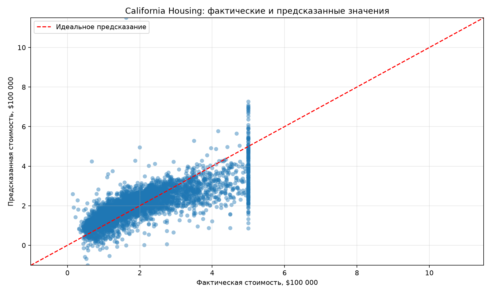

# Отчёт по практической работе №4

**Дисциплина:** Методы анализа и обработки больших данных  
**Тема:** Регрессионный анализ и оценка качества моделей

## Цель работы

Освоить построение линейной регрессии для предсказания числовой величины и оценить качество модели с помощью MAE, MSE и R².

## 1. Задача регрессии

Регрессия предсказывает числовое значение целевой переменной. В этой работе необходимо предсказать медианную стоимость дома по его характеристикам.

Использован набор данных California Housing из scikit-learn. Он содержит 20 640 районов Калифорнии и восемь числовых признаков. Целевая переменная `target` — медианная стоимость дома в сотнях тысяч долларов. При первой загрузке библиотека сохраняет кэш датасета в `practice-04/data/`; этот служебный кэш не включается в Git.

| Признак | Описание |
| --- | --- |
| `MedInc` | Медианный доход домохозяйства в районе |
| `HouseAge` | Медианный возраст домов |
| `AveRooms` | Среднее число комнат |
| `AveBedrms` | Среднее число спален |
| `Population` | Численность населения |
| `AveOccup` | Среднее число жильцов на домохозяйство |
| `Latitude` | Широта района |
| `Longitude` | Долгота района |

Код программы находится в [practice-04/main.py](practice-04/main.py).

## 2. Подготовка и обучение модели

Данные загружаются через `fetch_california_housing()` и преобразуются в DataFrame. В наборе нет категориальных столбцов и пропусков, поэтому кодирование или заполнение значений не требуется.

Независимые переменные записаны в `X`, целевая переменная — в `y`. Данные разделены на обучающую и тестовую части в соотношении 80/20 с `random_state=42`, поэтому результат воспроизводим. Обучающая выборка содержит 16 512 наблюдений, тестовая — 4 128.

```python
X = df.drop(columns="target")
y = df["target"]

X_train, X_test, y_train, y_test = train_test_split(
    X, y, test_size=0.2, random_state=42
)

model = LinearRegression()
model.fit(X_train, y_train)
y_pred = model.predict(X_test)
```

## 3. Принцип работы линейной регрессии

Линейная регрессия строит зависимость целевой переменной от признаков в форме:

`y = b₀ + b₁x₁ + b₂x₂ + … + bₙxₙ`

где `b₀` — свободный член, а коэффициенты `b₁ … bₙ` показывают вклад признаков. Во время обучения алгоритм подбирает коэффициенты так, чтобы суммарная квадратичная ошибка между фактическими и предсказанными значениями была минимальной.

## 4. Оценка качества

```python
mae = mean_absolute_error(y_test, y_pred)
mse = mean_squared_error(y_test, y_pred)
r2 = r2_score(y_test, y_pred)
```

| Метрика | Полученное значение |
| --- | ---: |
| MAE | 0.5332 |
| MSE | 0.5559 |
| R² | 0.5758 |

**MAE** (Mean Absolute Error) — средняя абсолютная ошибка. Она показывает среднее отклонение прогноза от фактического значения в единицах целевой переменной.

**MSE** (Mean Squared Error) — средняя квадратичная ошибка. Большие ошибки возводятся в квадрат, поэтому MSE сильнее реагирует на отдельные крупные промахи.

**R²** (коэффициент детерминации) показывает, какую долю изменчивости стоимости объясняет модель. Значение 1 соответствует идеальному прогнозу; 0 означает, что модель не лучше постоянного прогноза средним значением. R² может быть отрицательным на тестовых данных, если модель работает хуже такого простого прогноза.

В данном запуске MAE = 0.5332, то есть средняя абсолютная ошибка составляет примерно **53 320 долларов**, поскольку `target` измеряется в сотнях тысяч долларов. MSE = 0.5559 сильнее учитывает отдельные большие ошибки, поэтому его нельзя напрямую перевести в исходную денежную единицу без извлечения квадратного корня. R² = 0.5758 означает, что модель объясняет около **57.6%** разброса стоимости домов в тестовой части данных. Это полезный базовый результат, но он оставляет заметную долю необъяснённой изменчивости.

## 5. Визуализация результатов

Программа сохраняет диаграмму в [practice-04/report/actual_vs_predicted.png](practice-04/report/actual_vs_predicted.png). По горизонтали расположены фактические значения, по вертикали — предсказанные. Красная пунктирная линия `y = x` показывает идеальный прогноз.



Чем ближе точки к диагонали, тем точнее модель. Вертикальное расстояние до линии — ошибка прогноза. На графике заметна положительная связь: с ростом фактической стоимости предсказание в среднем растёт. Однако облако точек широко разбросано вокруг диагонали, особенно для дорогих домов, поэтому ошибки могут быть существенными.

У фактической стоимости видна вертикальная полоса около 5.0: в California Housing целевая переменная сверху ограничена значением 5.0. Из-за этого линейная регрессия не может точно отразить разброс реальных стоимостей за этим пределом. Это одна из причин, почему точки в этой области заметно отклоняются от идеальной линии.

## 6. Ответы на контрольные вопросы

### В чём основное отличие регрессии от классификации?

Регрессия предсказывает число, например стоимость дома или температуру. Классификация предсказывает категорию, например «выжил/погиб» или «спам/не спам».

### Почему важно использовать несколько метрик для оценки качества модели?

Каждая метрика показывает ошибку с другой стороны. MAE легко интерпретировать, MSE сильнее наказывает крупные ошибки, а R² показывает долю объяснённой изменчивости и не измеряется в единицах целевой переменной. Одна метрика может скрыть проблему, заметную по другой.

### Что означают значения R², близкие к 0 и к 1?

R², близкое к 1, означает, что модель объясняет большую часть разброса целевой переменной. Значение около 0 говорит, что модель почти не улучшает прогноз по сравнению с постоянным средним значением. На тестовых данных R² меньше 0 означает, что модель хуже такого простого прогноза.

## Вывод

В работе построена модель линейной регрессии для предсказания стоимости жилья California Housing. Данные разделены на обучение и тестирование, качество оценивается по MAE, MSE и R². Диаграмма фактических и предсказанных значений позволяет визуально оценить ошибки: близость точек к диагонали означает более точные прогнозы.
