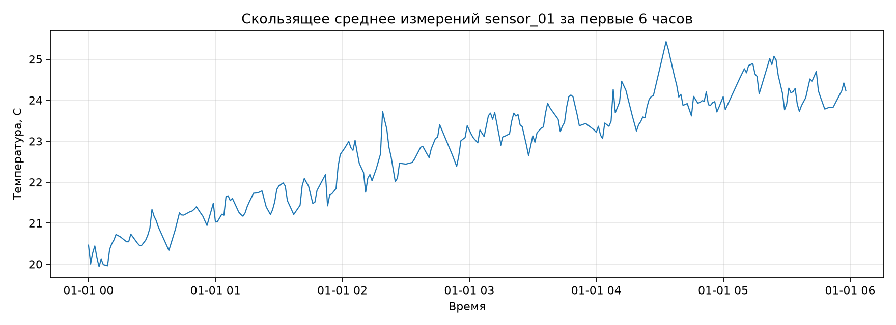

# Отчёт по практической работе №5

**Дисциплина:** Методы анализа и обработки больших данных  
**Тема:** Работа с большими наборами данных в Pandas и Dask

## Цель работы

Освоить чтение, предобработку и агрегацию больших CSV-файлов с сенсорными данными. Сравнить Pandas и Dask на одном наборе и определить, когда использовать каждый инструмент.

## 1. Исходные данные

Методичка задаёт схему `data/sensor_data.csv`, но не содержит готового файла. Поэтому программа создаёт воспроизводимый учебный набор при первом запуске. Он содержит **120 960 строк**: измерения 12 датчиков раз в минуту за 7 суток.

| Поле | Тип | Описание |
| --- | --- | --- |
| `sensor_id` | строка | Идентификатор датчика |
| `timestamp` | дата и время | Временная метка измерения |
| `measurement` | `float32` | Температурное измерение в градусах Цельсия |
| `unit` | строка | Единица измерения, `C` |
| `quality` | `float32` | Показатель качества от 0 до 1 |

В данных специально присутствуют 900 пропусков `measurement`; это позволяет выполнить требуемую обработку `ffill`. Исходный CSV и результаты Parquet создаются локально и исключены из Git, поскольку их можно получить повторным запуском программы.

Код работы: [practice-05/main.py](practice-05/main.py).

## 2. Загрузка и предобработка в Pandas

При чтении указаны типы данных и `parse_dates`. Это уменьшает потребление памяти и сразу превращает `timestamp` в дату и время.

```python
df = pd.read_csv(CSV_PATH, dtype=CSV_DTYPES, parse_dates=["timestamp"])
cleaned = df.loc[df["quality"] >= 0.8].copy()
cleaned = cleaned.sort_values(["sensor_id", "timestamp"])
cleaned["measurement"] = cleaned.groupby("sensor_id")["measurement"].ffill()
cleaned["hour"] = cleaned["timestamp"].dt.floor("h")
```

Порядок действий:

1. Строки с `quality < 0.8` отфильтрованы.
2. Данные отсортированы по датчику и времени.
3. Пропуски измерений заполняются последним известным значением того же датчика методом прямой подстановки.
4. Создана колонка `hour` с округлением временной метки вниз до часа.

Результат проверки:

| Показатель | Значение |
| --- | ---: |
| Строк до фильтрации | 120 960 |
| Строк после `quality >= 0.8` | 80 505 |
| Пропусков `measurement` после `ffill` | 0 |
| Уникальных датчиков | 12 |

## 3. Почасовая агрегация и rolling в Pandas

Для каждого датчика и часа рассчитано среднее измерение:

```python
hourly_pandas = (
    cleaned.groupby(["sensor_id", "hour"], as_index=False)["measurement"]
    .mean()
    .rename(columns={"measurement": "mean_measurement"})
)
```

Получено **2 016** почасовых групп: 12 датчиков × 7 дней × 24 часа. Результат сохранён в `practice-05/report/hourly_pandas.parquet` через `fastparquet`.

Для `sensor_01` дополнительно рассчитано скользящее среднее по окну 5 минут:

```python
rolling = (
    sensor.set_index("timestamp")["measurement"]
    .rolling("5min")
    .mean()
)
```



Скользящее среднее уменьшает влияние минутного шума и показывает общий ход температуры. На графике прослеживается суточное изменение: температура растёт ночью и утром, а затем колеблется около более высокого значения.

## 4. Аналогичная обработка в Dask

Dask читает CSV лениво: данные разбиваются на партиции и не загружаются целиком в память в момент вызова `dd.read_csv()`.

```python
ddf = dd.read_csv(
    CSV_PATH,
    dtype=CSV_DTYPES,
    parse_dates=["timestamp"],
    blocksize="512 KiB",
)

hourly_dask = (
    cleaned.groupby(["sensor_id", "hour"])["measurement"]
    .mean()
    .reset_index()
)
```

Фактическое выполнение графа происходит при `compute()`. В данном запуске исходный CSV разделён на **12 партиций**. Каждая партиция сохранена в отдельном Parquet-файле `practice-05/report/hourly_dask/part-*.parquet`.

Для учебного набора CSV заранее упорядочен по датчику и времени. Это позволяет корректно применять прямую подстановку внутри партиций. В реальном распределённом проекте нужно отдельно контролировать границы партиций: для гарантированного `ffill` по времени может потребоваться `set_index`, overlap или иная стратегия подготовки.

## 5. Сравнение Pandas и Dask

Измерение выполнено `time.perf_counter()`. Память процесса наблюдалась через `psutil` и является ориентировочной: в неё входят интерпретатор Python и ранее созданные объекты.

| Показатель | Pandas | Dask |
| --- | ---: | ---: |
| Время выполнения | 0.1318 с | 0.4664 с |
| Изменение памяти процесса | 50.42 MiB | 9.52 MiB |
| Результат агрегации | 2 016 строк | 2 016 строк |

Максимальная абсолютная разница между почасовыми средними Pandas и Dask составила **0.00000260**. Она вызвана порядком вычислений с числами `float32` и не влияет на интерпретацию результата.

На этом относительно небольшом наборе Pandas быстрее: Dask несёт расходы на построение и выполнение вычислительного графа. Dask показал меньшее приращение памяти процесса и становится предпочтительнее, когда CSV не помещается в RAM, когда данных намного больше или когда вычисления можно эффективно распараллелить.

## 6. Когда использовать Pandas и Dask

| Условие | Подход |
| --- | --- |
| Данные помещаются в оперативную память, нужен быстрый интерактивный анализ | Pandas |
| Данные больше доступной RAM | Dask |
| Требуются сложные `groupby`, `resample`, `rolling` и удобная отладка | Pandas |
| Нужна параллельная обработка больших CSV или Parquet | Dask |
| Результат грубой агрегации помещается в память | Dask для агрегации, затем Pandas для финального анализа |

Для промежуточных результатов стоит использовать Parquet: это колонковый формат, который обычно компактнее CSV и быстрее читается для аналитических задач. В Dask следует по возможности избегать частых `set_index` и shuffle: эти операции требуют дорогого обмена данными между партициями.

## Вывод

Выполнены чтение, очистка, заполнение пропусков, почасовая агрегация и скользящее среднее для сенсорных данных. Оба инструмента сформировали согласованные почасовые результаты. Pandas оказался быстрее на учебном наборе, а Dask показал подход к обработке данных по частям и экономию дополнительной памяти. Выбор библиотеки зависит прежде всего от объёма данных, доступной RAM и характера операций.

## Запуск

Из корня репозитория:

```bash
source .venv/bin/activate
python -m pip install -r requirements.txt
python practice-05/main.py
```
